<!-- page 1 -->

## **Lecture #03: Database Storage (Part I)**

**15-445/645 Database Systems (Fall 2025)**

https://15445.courses.cs.cmu.edu/fall2025/ Carnegie Mellon University Andy Pavlo

source:
https://15445.courses.cs.cmu.edu/fall2025/notes/03-storage1.pdf

### **1** **Storage**

In this class, we focus on a “disk-oriented” DBMS architecture that assumes that the primary storage location of the database is on non-volatile disk(s).

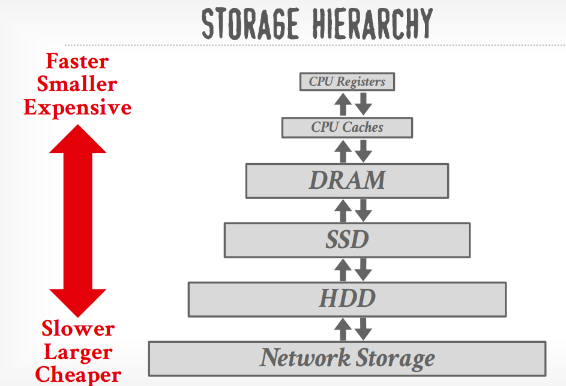

At the top of the storage hierarchy, you have the devices that are closest to the CPU. This is the fastest storage, but it is also the smallest and most expensive. The further you get away from the CPU, the larger but slower the storage devices get. These devices also get cheaper per GB.

There’s also a demarcation line in the middle of the hierarchy that separates volatile devices from non-volatile devices.

**Volatile Devices**

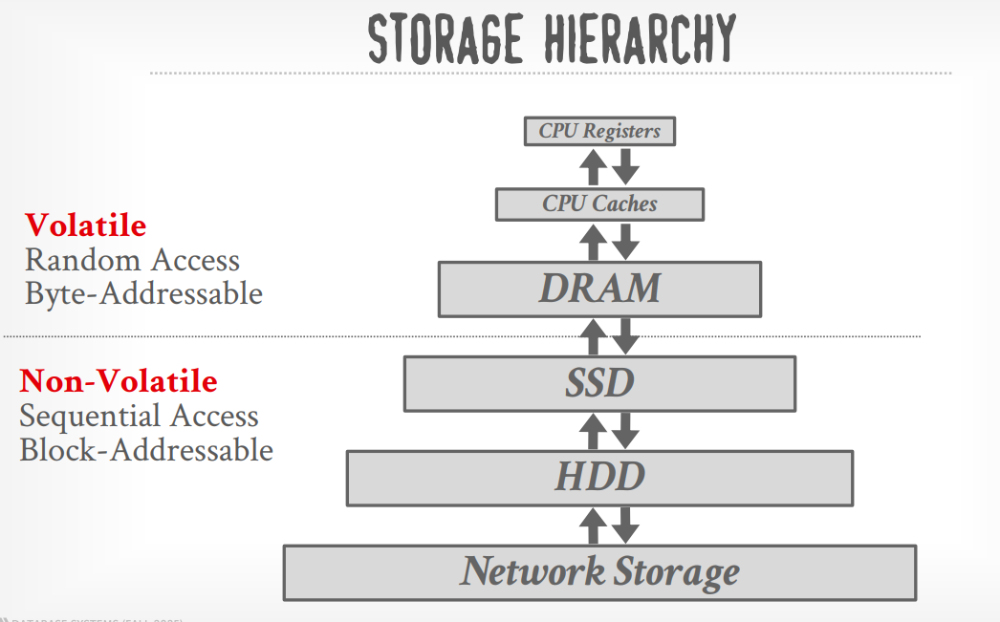

- Volatile means that the device does not retain its state after power loss. Therefore, the data that is stored in such devices can be lost.

- Volatile storage supports fast random access with byte-addressable locations. This means that the program can jump to any byte address and get the data that is there (e.g. in DRAM).

- For our purposes, we will always refer to this volatile storage class as “memory.”

**Non-Volatile Devices**

- Non-volatile devices do retain their state even when the machine/computer is off or power loss occurs. Therefore, the data that these devices store can be retrieved even after the machine/computer shuts down and restarts (e.g. disk).

- Non-Volatile devices are block/page addressable. This means that in order to read a value at a par-ticular offset (byte), the program first has to load the 4 KB page into memory that holds the value that the program wants to read.

- Non-volatile storage is traditionally better at sequential access (reading contiguous blocks of data because of its architecture e.g. magnetic hard drive).

- We will refer to this as “disk.” We will not make a (major) distinction between solid-state storage (SSD) and spinning hard drives (HDD).

### **2** **Access Time and Access Pattern**
- [interactive_latency](https://colin-scott.github.io/personal_website/research/interactive_latency.html)
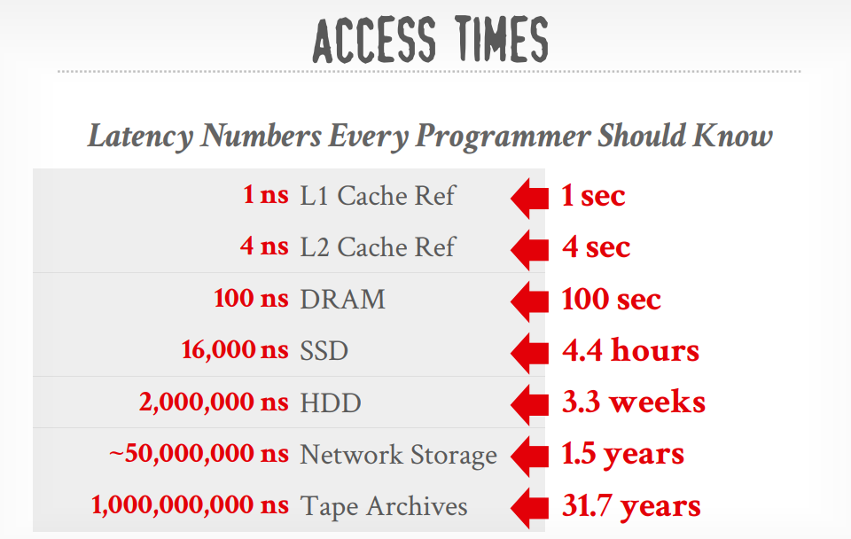


There is a large contrast between latencies accessing volatile vs. non-volatile devices. In order to better understand the orders of magnitute of latency difference, suppose that reading data from the L1 cache reference took one second, then reading from an SSD would take 4.4 hours, and reading from an HDD would take 3.3 weeks.

There are two major access patterns, *random access* and *sequential access* . On real-world hardwares the differences between their access latencies are significant. Random access on non-volatile storage is almost always slower than sequential access. 

→ Random I/O: 80–100 μs
→ Sequential I/O: 10–100 μs

The DBMS will always target maximizing sequential access, some systems will avoid blocking on random writes by writing sequentially into a buffer and later perform random disk writes in the background.

DBMS will want to maximize sequential access.
→ Algorithms try to reduce number of writes to random pages so
that data is stored in contiguous blocks.
→ Allocating multiple pages at the same time is called an extent.


### **3** **System Design Goals**

A design goal of the disk-oriented DBMS is to allow it to manage databases that **exceeds** the amount of memory available. As this requires frequent data movement between memory and disk, the DBMS should manage disk read and write carefully to avoid long stalls on disk I/O and maximize sequential access when possible.

### **4** **Disk-Oriented DBMS Overview**

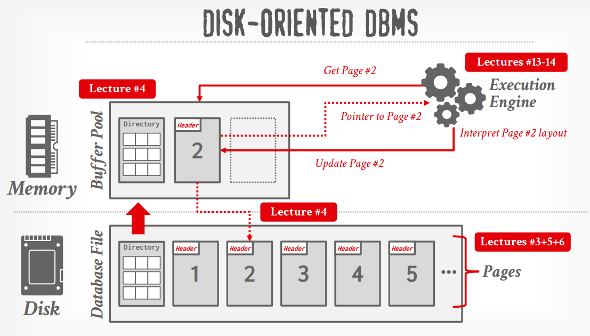

- **Pages**: The database is stored on disk, and the data within the database files are organized into **pages**, with the first page being the **directory page**. 
- **Buffer Pool**: To operate on the data, the DBMS needs to bring the data into memory. It does this by having a **buffer pool** that manages the data movement back and forth between disk and memory. The DBMS also has an execution engine that will execute queries. 
- **Execution Engine**: The execution engine will ask the buffer pool for a specific page, and the buffer pool will take care of bringing that page into memory and giving the execution engine a pointer to that page in memory. The buffer pool manager will ensure that the page is there while the execution engine operates on that part of memory.

### **5** **DBMS vs. OS**

A high-level design goal of the DBMS is to support databases that exceed the amount of available memory. Since reading/writing to disk is expensive, disk use must be carefully managed. We do not want large stalls from fetching something from disk to slow down everything else. We want the DBMS to be able to process other queries while it is waiting to get the data from disk.

This high-level design goal is like virtual memory, where there is a large address space and a place for the

OS to bring in pages from disk.

One way to achieve this virtual memory is by using mmap to map the contents of a file in a process’ ad-

dress space, which makes the OS responsible for moving pages back and forth between disk and memory.

Unfortunately, this means that if mmap hits a page fault, the process will be blocked.

- You never want to use mmap in your DBMS if you need to write.

- The DBMS (almost) always wants to control things itself and can do a better job at it since it knows

more about the data being accessed and the queries being processed.

- The operating system is not your friend.

It is possible to use the OS by using:

- madvise : Tells the OS know when you are planning on reading certain pages.

- mlock : Tells the OS to not swap memory ranges out to disk.

- msync : Tells the OS to flush memory ranges out to disk.

We do not advise using mmap in a DBMS for correctness and performance reasons.

Even though the system will have functionalities that seem like something the OS can provide, having the DBMS implement these procedures itself gives it better control and performance.


### **6** **File Storage**

#### File System
In its most basic form, a DBMS stores a database as files on disk. Some may use a file hierarchy, others may use a single file (e.g. SQLite).

The DBMS traditionally store files in a proprietary format that are specific to the DBMS, therefore only the specific DBMS knows how to decipher their contents. 
1. Early systems in the 1980s used custom filesystems on raw block storage.
→ Some enterprise DBMSs still do this 
- [Oracle](https://www.oracle.com/technetwork/products/cloud-storage/oracle-12c-asm-overview-1965430.pdf)
- [Teradata](https://docs.teradata.com/r/Enterprise_IntelliFlex_VMware/Database-Utilities/Ferret-Utility-ferret/The-File-System)

2. More recently there are also portable file formats(Ex, **parquet**) that are open specs which allow all DBMSs to read and write from them. 
  
For either approach, the OS does not know anything about the contents of these files.


The DBMS typically runs on off-the-shelf file system provided by the OS. There are some high-end enter-prise systems that could inject a custom file system into the OS specific for the DBMS (e.g. Oracle ASM)

#### Storage manager

The DBMS’s storage manager is responsible for managing a database’s files. It represents the files as a collection of pages. 
→ Some do their own scheduling for reads and writes to improve spatial and temporal locality of pages.

- It organizes the files as a collection of pages.
→ Tracks data read/written to pages.
→ Tracks the available space.


- Replication is not handled on storage manager level. 
Typically they are handled either in the file system below the storage manager (e.g. RAID), or above the storage manager where there could be logical copies of tuples.

### **7** **Database Pages**

#### Pages
The DBMS organizes the database across one or more files in fixed-size blocks of data called pages . 
A page is a fixed-size block of data.
→ It can contain tuples, meta-data, indexes, log records…
→ Most systems do not mix page types.
→ Some systems require a page to be self-contained.


Pages can contain different kinds of data (tuples, indexes, etc). Most systems will not mix these types within pages. Some systems will require that pages are self-contained , meaning that all the information needed to read each page is on the page itself.

#### page ID
Each page is given a unique identifier (**page ID**). 

If the database is a single file, then the page id can just be the file offset. 
A page ID could be unique per DBMS instance, per database, or per table. 
Most DBMSs have an indirection layer that maps a page id to a file path and offset. 
The upper levels of the system will ask for a specific page number. Then, the storage manager will have to turn that page number into a file and an offset to find the page.

Most DBMSs use fixed-size pages to avoid the engineering overhead needed to support variable-sized pages. For example, with variable-size pages, deleting a page could create a hole in files that the DBMS cannot easily fill with new pages.


#### three concepts of pages in DBMS
There are three concepts of pages in DBMS:
1. Hardware page (usually 4 KB).
2. OS page (usually 4 KB, x64 2MB/1GB).
3. Database page (512B -32 KB).

The storage device guarantees an atomic write of the size of the hardware page. If the hardware page is 4 KB and the system tries to write 4 KB to the disk, either all 4 KB will be written, or none of it will.

This means that if our database page is larger than our hardware page, the DBMS will have to take extra measures to ensure that the data gets written out safely since the program can get partway through writing a database page to disk when the system crashes.


Optimal database page size depends on the environment, database contents, and expected workload. 
- DBMSs that specialize in read-only workloads tend to have larger page sizes (>= 1MB), 
  → Fetching a single page brings in many tuples that are needed for a query.
- while those that specialize in write-heavy workloads tent to have smaller pages (4-16KB).
  → The system must write entire page to disk even if only a small portion of it is modified.

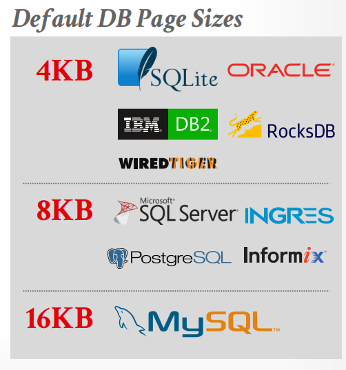


### **8** **Page Storage Architecture/Database Heap**

Different DBMSs manage pages in files on disk in different ways.
→ Heap File Organization
→ Tree File Organization
→ Sequential / Sorted File Organization (ISAM)
→ Hashing File Organization

A heap file is an unordered collection of pages where tuples are stored in random order.

A common architecture for the DBMS to locate a page on disk given a page id is page directory , which are special pages that contain one location entry for each logical database objects (e.g. data pages, index pages). The page directory has to be synchronized with the actual pages. The DBMS also tracks metadata about pages’ contents, include the amount of free space on each page, a list of free/empty pages, and the page types.

#### Heap File Organization
A heap file is an unordered collection of pages with tuples that are stored in random order.
→ Create / Get / Write / Delete Page
→ Must also support iterating over all pages.

Need additional meta-data to track location of files and free space availability. 

#### HEAP FILE: PAGE DIRECTORY
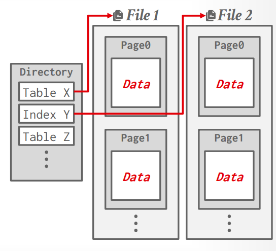

The DBMS maintains special pages that tracks the location of data pages in the database files.
→ One entry per database object.
→ Must make sure that the directory pages are in sync with the data pages.

DBMS also keeps meta-data about pages' contents:
→ Amount of free space per page.
→ List of free / empty pages.
→ Page type (data vs. meta-data).

### **9** **Page Layout**

#### Page Header
Every page includes a header that records meta-data about the page’s contents:

- Page size.
- Checksum.
- DBMS version.
- Transaction visibility.
- Compression / Encoding Meta-data
- Schema Information
- Data Summary / Sketches

- Self-containment. (Some systems like Oracle require this.)


#### Page Data

For any page storage architecture, we now need to decide how to organize the data inside of the page.
→ We are still assuming that we are only storing tuples in a row-oriented storage model.
→ We will also assume that an each tuple fits in a single page.


There are three main approaches to laying out data in pages: 
(1) tuple-oriented, 
(2) log-structured, 
(3) index-oriented.

##### Tuple-Oriented Storage

In tuple-oriented storage, the entire tuple is stored in the page. 

A strawman approach: 
to laying out tuples in a page is to keep track of how many tuples the DBMS has stored in the page and then append to the end every time a new tuple is added. 

However, problems arise when tuples are deleted or when tuples have variable-length attributes. 

##### Slotted Pages
A common layout scheme that solves this is slotted pages .

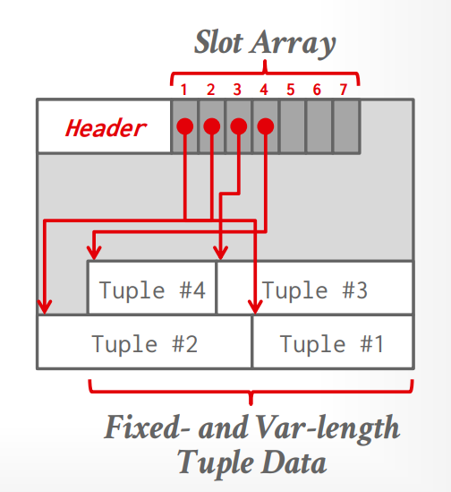


**Slotted Pages:** Page maps slots to offsets.

- Most common approach used in DBMSs today.

- Header keeps track of the number of used slots, the offset of the starting location of the last used

slot, and a slot array, which keeps track of the location of the start of each tuple.

- To add a tuple, the slot array will grow from the beginning to the end, and the data of the tuples will

grow from end to the beginning. The page is considered full when the slot array and the tuple data

meet.

Log-structured and index-oriented storage are covered in lecture 05.

### **10** **Record IDs**
The DBMS assigns each logical tuple a unique record identifier that represents its physical location in the database.
→ Example: File Id, Page Id, Slot #
→ Most DBMSs do not store ids in tuple.
→ SQLite uses ROWID as the true primary key and stores them as a hidden attribute.

Since these are physical locations within the DBMS, the application **cannot** rely on these IDs.

Common record id size varies from 4 bytes to 10 bytes.
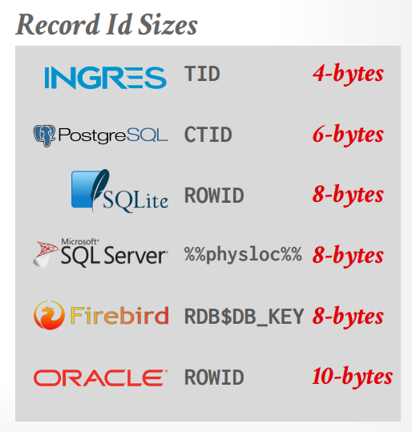


### **11** **Tuple Layout**

#### Tuple Header

**Tuple Header:** Contains meta-data about the tuple.
A tuple is essentially a sequence of bytes (these bytes do not have to be contiguous). It is the DBMS’s job to interpret those bytes into attribute types and values.


- Visibility information for the DBMS’s concurrency control protocol (i.e., information about which transaction created/modified that tuple, will be covered later in the semester).

- Bit Map for NULL values.

- Note that the DBMS does not need to store meta-data about the schema of the database here.

#### Tuple Data

**Tuple Data:** Actual data for attributes.
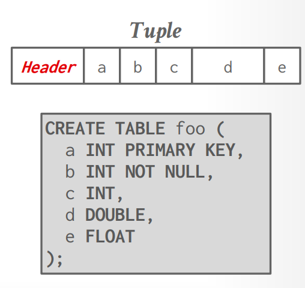


- Attributes are typically stored in the order that you specify them when you create the table.
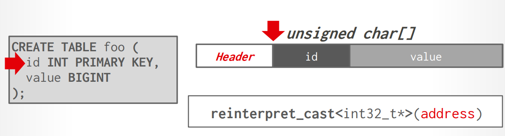

- Attributes must be **word aligned**.
  All attributes in a tuple must be word aligned to enable the CPU to access it without any unexpected behavior or additional work.

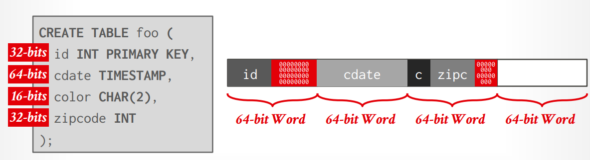


- Most DBMSs do not allow a tuple to exceed the size of a page.


### **12** **Data Representation**

Data representation defines the attribute storage format. Storage formats for common data types are de- scribed below.

#### INTEGER / BIGINT / SMALLINT / TINYINT

Storage layout follows native format in C/C++.

#### TIME / DATE / TIMESTAMP / INTERVAL

Stored as 32/64-bit integer of micro or milli-seconds since Unix epoch.


#### FLOAT / REAL vs. NUMERIC / DECIMAL

Storage layout follows IEEE-754 Standard or Fixed-point Decimals.

#####  Variable precision numbers

Are ”native” C/C++ types stored as specified by IEEE-754. They are **inexact** but typically **faster** than fixed precision numbers due to CPU ISA’s instruction and register support.

##### Fixed precision numbers
Numeric data types with (potentially) arbitrary precision and scale. Used when rounding errors are unacceptable.
→ Example: NUMERIC, DECIMAL
It means the number is represented with decimal precision semantics, rather than approximate floating-point semantics.


Allows arbitrary precision and scale. One of many possible implementations is storing in exact,variable-length binary.
- Precision ： Total number of significant decimal digits.
- Scale： Number of digits after the decimal point.

```
Ex: 12345.67
Precision = 7
Scal =2

```
Many different implementations.
→ Example: Store in an exact, variable-length binary representation with additional meta-data.
→ Can be less expensive if the DBMS does not provide arbitrary precision (e.g., decimal point can be in a different position per value).


```c
// POSTGRES: NUMERIC
typedef unsigned char NumericDigit;
typedef struct {
 int ndigits; //# of Digits
 int weight; // Weight of 1st Digit
 int scale;  // Scale Factor
 int sign;  // Positive/Negative/NaN
 NumericDigit *digits; //Digit Storage
} numeric;


NUMERIC(10,2)
// means:  maximum 10 decimal digits, 2 digits after decimal point
12345678.90   ✓
123456789.01   ✗ // because that's 11 digits of precision.
```

| Type      | Example   | Exact? | Typical storage |
| --------- | --------- | -----: | --------------- |
| `INTEGER` | `12345`   |    Yes | fixed-size      |
| `DOUBLE`  | `123.456` |     No | fixed-size      |
| `NUMERIC` | `123.456` |    Yes | variable-size   |


#### Null Data Types

There are several approaches to storing null data types.

- Choice #1: Null Column Bitmap Header
→ Store a bitmap in a centralized header that specifies what attributes are null.
→ This is the most common approach in row-stores.

- Choice #2: Special Values
  Designate a placeholder value to represent NULL for a data type(e.g., INT32_MIN). 
  More common in column-stores.


- Choice #3: Per Attribute Null Flag
→ Store a flag that marks that a value is null.
→ Must use more space than just a single bit because this messes up with word alignment.

#### VARCHAR / VARBINARY / TEXT / BLOB

Stored as header with length with data bytes **or** pointer to data page and offset.
Need to worry about collations / sorting.

##### LARGE VALUES

- **Overflow Pages**
When the value cannot fit in a single page, separate overflow pages are used and record id to the tuple is stored inline. Optimizations are possible to compress the overflow page; or to store the prefix of the value inline to reduce indirection when scanning.


Most DBMSs do not allow a tuple to exceed the size of a single page.
To store values that are larger than a page, the DBMS uses separate overflow storage pages.
→ Postgres: TOAST (>2KB)
→ MySQL: Overflow (>½ size of page)
→ SQL Server: Overflow (>size of page)

Lots of potential optimizations:
→ Overflow Compression, German String

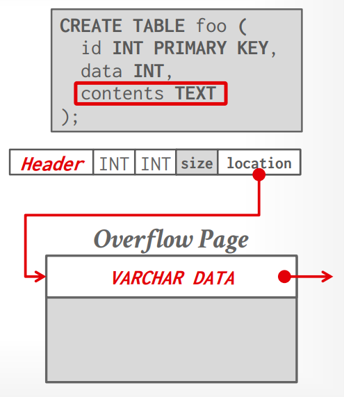


### External Value Storage

Some system allow large value to be stored in external file and treated as BLOB type. 

→ Oracle: BFILE data type
→ Microsoft: FILESTREAM data type


The DBMS cannot manipulate the contents of an external file.
→ No durability protections.
→ No transaction protections.
