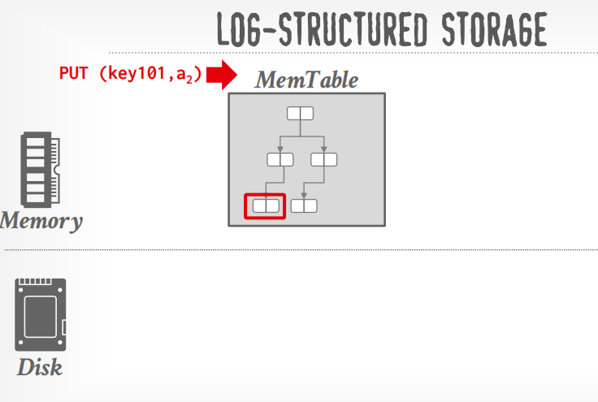
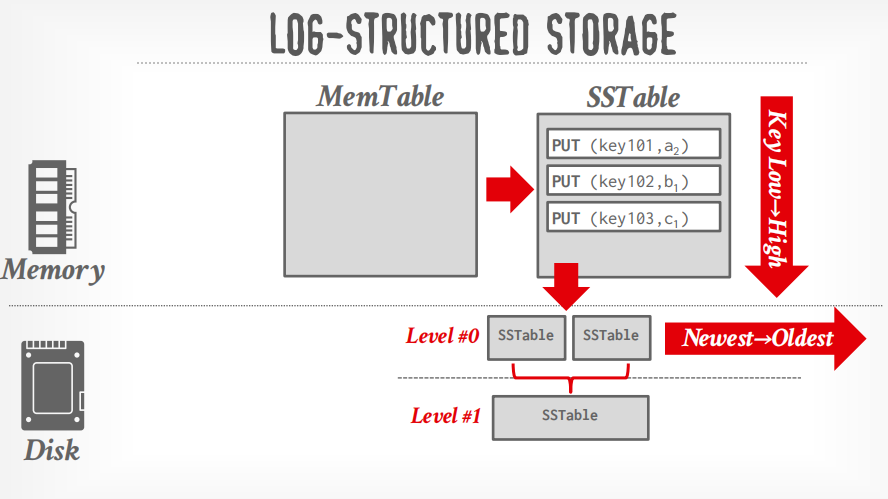
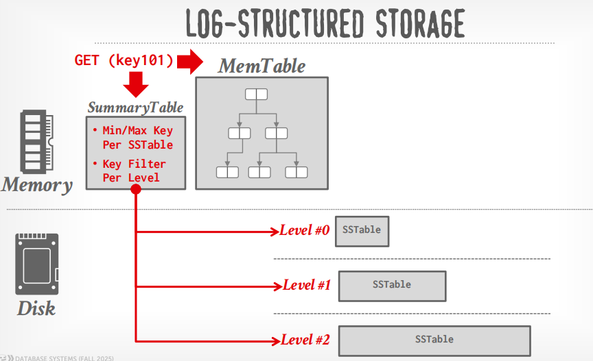
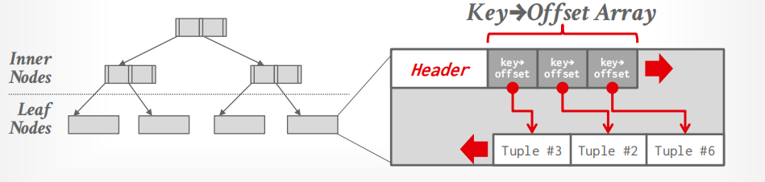

**Lecture #05: Database Storage (Part II) 15-445/645 Database Systems (Fall 2025)** https://15445.courses.cs.cmu.edu/fall2025/ Carnegie Mellon University Andy Pavlo 

# **1 Buffer Pool Optimizations** 

There are several ways to optimize a buffer pool to tailor it to the application’s workload. 

## **Multiple Buffer Pools** 

The DBMS can maintain multiple buffer pools for different purposes (i.e. per-database, per-table, per-page type, etc.). 
→ Multiple buffer pool instances
→ Per-database buffer pool
→ Per-page type buffer pool

Then, each buffer pool can adopt **local policies** tailored to the data stored inside of it. This method can help reduce **latch contention** and **improve locality**. 


Object IDs and hashing are two approaches to mapping desired pages to a specific buffer pool. 

### Approach #1: Object Id

- **Object IDs** involve extending the record IDs to have an object identifier. A mapping from objects to specific buffer pools can be maintained via these object IDs. This allows a finer-grained control over buffer pool allocations but has a storage overhead. 

### Approach #2: Hashing

- Another approach is **hashing** , where the DBMS hashes the page ID to select which buffer pool to access. This is a more general and uniform approach. 


### Why do we use Multiple Buffer Pools?

The core idea is **isolation**.

假设 DBMS 只有一个 Buffer Pool：

```text
                  DBMS
                   |
            +--------------+
            | Buffer Pool  |
            |  1000 pages  |
            +--------------+
              /     |     \
             /      |      \
         Table A  Table B  Table C
```

所有 page 的访问都集中到这个 Buffer Pool。

Buffer Pool 内部通常会有一些共享的数据结构，例如：

```text
Buffer Pool
    |
    +-- Page Table
    |      page_id -> frame_id
    |
    +-- Free List
    |
    +-- Replacement Policy
           |
           +-- LRU / LRU-K / Clock ...
```

多个线程同时访问：

```text
Thread 1 ---> Buffer Pool
Thread 2 ---> Buffer Pool
Thread 3 ---> Buffer Pool
Thread 4 ---> Buffer Pool
```

那么它们可能需要竞争同一个 latch。

---

现在把它拆开：

```text
                  DBMS
                   |
       +-----------+-----------+
       |           |           |
       v           v           v
    Pool 0       Pool 1      Pool 2
   Table A      Table B      Table C
     OLTP      Scan      Index
```

或者：

```text
Pool 0:  Page 0, 4, 8, 12 ...
Pool 1:  Page 1, 5, 9, 13 ...
Pool 2:  Page 2, 6, 10, 14 ...
Pool 3:  Page 3, 7, 11, 15 ...
```

这样每个 Buffer Pool 有自己的：

```text
Page Table
Free List
Replacement Policy
Latches
```

这就是所谓的 **local**。

---


#### 1. Reduce latch contention

Different threads can access different Buffer Pools:

```text
Thread 1 → Pool 0 → Latch 0
Thread 2 → Pool 1 → Latch 1
```

Less competition for the same shared data structures.


##### "reduce latch contention" 是什么意思？
假设一个 Buffer Pool 有一个共享 latch：

```text
                 Buffer Pool
                     |
                 [Latch]
                     |
          +----------+----------+
          |          |          |
        Thread 1   Thread 2   Thread 3
```

如果三个线程同时访问：

```text
Thread 1: lookup page
Thread 2: lookup page
Thread 3: evict page
```

它们可能需要竞争：

```text
        Latch
          |
    +-----+-----+
    |           |
 Thread 1     Thread 2
    |
   lock
    |
 Thread 3 waits
```

这就是 **latch contention**。

---


如果 page 被分散到不同 Buffer Pool：

```text
                  DBMS
                   |
          +--------+--------+
          |                 |
          v                 v
      Buffer Pool 0     Buffer Pool 1
          |                 |
       [Latch 0]          [Latch 1]
          |                 |
       Thread 1          Thread 2
```

那么：

```text
Thread 1 ---> Pool 0 ---> Latch 0
Thread 2 ---> Pool 1 ---> Latch 1
```

两者就可以**并行执行**。

因此：

```text
Single Buffer Pool

Thread 1 ──┐
Thread 2 ──┼──> same latch
Thread 3 ──┘
              ↓
          contention
```

变成：

```text
Multiple Buffer Pools

Thread 1 ──> Pool 0 ──> Latch 0
Thread 2 ──> Pool 1 ──> Latch 1
Thread 3 ──> Pool 2 ──> Latch 2
```

于是 contention 降低。

---


#### 2. Improve locality

Different workloads have different access patterns.

For example:

```text
Pool 0: hot OLTP pages
Pool 1: sequential-scan pages
```

A large scan in Pool 1 won't easily evict the hot pages in Pool 0.

→ **Less cache pollution, better cache hit rate.**


##### "improve locality" 又是什么意思？

这里的 **locality** 主要指 **cache locality / access locality**。

假设某个 table 的 page 经常一起访问：

```text
Table A:

Page 100
Page 101
Page 102
Page 103
Page 104
```

如果这些 page 都进入同一个 Buffer Pool：

```text
Pool A

+-----+-----+-----+-----+-----+
|100  |101  |102  |103  |104  |
+-----+-----+-----+-----+-----+
```

那么这个 Pool 的 replacement policy 看到的是一个比较一致的访问模式。

例如：

```text
100 -> 101 -> 102 -> 100 -> 101 -> 102
```

它很容易发现：

> 这些 page 经常一起使用。

于是缓存可以更加有效。

---

一个更重要的例子， 假设：

```text
Buffer Pool = 100 pages
```

里面同时缓存：

```text
Table A: 50 pages
Table B: 50 pages
```

突然 Table B 做一个大 sequential scan：

```text
B1 -> B2 -> B3 -> ... -> B1000
```

这些 page 会不断进入 Buffer Pool。

可能导致：

```text
A1
A2
A3
...
A50
```

被大量 B 的 page 淘汰。

这叫：

> **cache pollution**

也可以理解成 **locality 被破坏**。

---

如果我们使用多个 Buffer Pools：

```text
Pool A
+----------------+
| A1 A2 A3 ...   |
|      50 pages  |
+----------------+

Pool B
+----------------+
| B1 B2 B3 ...   |
|      50 pages  |
+----------------+
```

那么 B 的 sequential scan 主要污染：

```text
Pool B
```

而不会把：

```text
Pool A
```

里面的热点 page 大量赶出去。

所以 **locality improves**。

---

#### 3. Use specialized replacement policies

Each pool can choose a policy appropriate for its workload:

```text
Pool 0 → LRU-K     (hot OLTP data)
Pool 1 → scan-aware policy
Pool 2 → index-oriented policy
```

#### 4. Better resource control

You can allocate memory separately:

```text
OLTP pool    → 60% memory
Analytics    → 30%
Indexes      → 10%
```

This prevents one workload from consuming the entire buffer pool.

##### "adopt local policies" 是什么意思？

> each buffer pool can adopt local policies tailored to the data stored inside of it.

意思是：

> **每个 Buffer Pool 可以根据自己负责的数据的访问特征，使用不同的 Buffer Replacement Policy。**

例如有两种数据：

###### Pool A：热点 OLTP 数据

```text
Customer table
Order table
```

访问模式：

```text
page 10
page 20
page 10
page 30
page 10
page 20
...
```

这些 page 经常被重复访问。

那么 Pool A 可以采用：

```text
LRU-K
```

或者其他比较重视频繁访问的 replacement policy。

---

###### Pool B：大型分析表

例如：

```text
Sales history
```

查询可能是：

```sql
SELECT ...
FROM sales
WHERE date BETWEEN ...;
```

导致：

```text
page 1
page 2
page 3
page 4
page 5
...
```

大量 sequential scan。

这时候传统 LRU 可能并不理想，因为：

```text
page 1 -> page 2 -> page 3 -> page 4 -> ...
```

不断把旧 page 挤出去。

所以这个 Buffer Pool 可以使用更适合 sequential scan 的策略，例如降低 scan pages 对缓存的污染。

---

##### 为什么这叫 "local policy"？

因为如果只有一个 Buffer Pool：

```text
                  Replacement Policy
                         |
             +-----------+-----------+
             |           |           |
          Table A     Table B     Table C
```

replacement policy 必须同时考虑：

```text
Table A 的访问模式
Table B 的访问模式
Table C 的访问模式
```

但是如果拆成：

```text
             Buffer Pool
                  |
       +----------+----------+
       |                     |
       v                     v
   Pool A                 Pool B
     |                       |
   Table A                 Table B
     |                       |
   Policy A                Policy B
```

那么：

```text
Pool A -> 针对 Table A 优化
Pool B -> 针对 Table B 优化
```

这就是：

> **local policies tailored to the data stored inside of it**


---

#### One-sentence summary

> **Multiple Buffer Pools partition the buffer cache so that different workloads can have independent policies, memory resources, and synchronization, reducing contention and cache pollution while improving locality.**

Think of it as **“don't let unrelated workloads fight over the same cache.”**


可以记住三个关键词：

```text
Multiple Buffer Pools
        |
        +--------------------+
        |                    |
        v                    v
   Local Policy          Less Sharing
        |                    |
        v                    v
  better replacement     less latch contention
        |
        v
   better locality
```

---

**Multiple Buffer Pools 并不是简单地意味着“每张表一个 Buffer Pool”。**

真正的核心思想是：

> **把具有不同访问特征的数据隔离开。**

例如：

```text
                 Buffer Manager
                       |
       +---------------+---------------+
       |               |               |
       v               v               v
   Pool 0          Pool 1           Pool 2
   OLTP            Sequential       Index
   hot data        scan data       pages
```

这样每个 Pool 可以有不同的：

* replacement policy
* memory allocation
* eviction behavior
* latch
* locality

所以你在学习 BusTub / CMU 15-445 的 Buffer Pool 时，可以把这句话理解成：

> **Multiple Buffer Pools = resource partitioning + policy isolation + synchronization isolation。**

其中 **policy isolation** 和 **synchronization isolation** 是理解这段话最重要的两个点。


## **Pre-fetching** 

The DBMS can also be optimized by pre-fetching pages based on the query plan. While the first set of pages is being processed, the second can be pre-fetched into the buffer pool. This method is commonly used by DBMSs when accessing many pages sequentially during a sequential scan. It is also possible for a buffer pool manager to prefetch leaf pages in a tree index data structure benefiting index scans. Note that this does not necessarily need to be the next physical page on disk, but instead the next logical page in the leaf scan. 


## **Scan Sharing (Synchronized Scans)** 

Query cursors can reuse data retrieved from storage or operator computations. This allows multiple queries to attach to a single cursor that scans a table. If a query starts a scan and there is another active scan, then the DBMS will attach the second query’s cursor to the existing cursor. The DBMS keeps track of where the second query joined with the first so that it can finish the scan when it reaches the end of the data structure. This satisfies correctness since the order of scans is not guaranteed by a DBMS and is often useful when a table is frequently scanned. 

**Note:** Continuous scan sharing is an academic prototype that constantly runs a sequential scan for certain tables and queries can hop on and off. However, this is very wasteful and costly when paying per I/O. 

Overall, the DBMS can almost always manage memory better than the OS. It can leverage the semantics about the query plan to make better decisions: 

- Evictions 

- Allocations 

- Pre-fetching 

To reiterate, the Operating System is **_<u>not</u>_** your friend. 


# **2 Tuple-Oriented Storage** 

The most common way to store tuples on disk is the Tuple-Oriented Storage architecture, using the slotted page scheme described in previous lectures. Tuples are retrieved using its record ID: 
## CRUD 
### GET
Get an existing tuple using its record id:
- Check the page directory to find the page position on disk. 
- Fetch the page from disk into memory (into the buffer pool). 
- Use the slot array to find the tuple’s offset within the page. 


The DBMS relies on **indexes** to find individual tuples because the tables are inherently unsorted.
But what if the DBMS could keep tuples sorted automatically using an index? 
-> INDEX-ORGANIZED STORAGE


### UPDATE

Inserting a new tuple is simple: 

- Check the page directory to find a page with a free slot. 

- Fetch the page from disk into memory. 

- Use the slot array to check if there is enough free space in the page. 

- If not, find another page with a free slot or create a new page. 

- Insert the tuple into the page and update the slot array. 

### Updating tuples 
However, updating tuples can become expensive: 

- Navigate to the tuple using the record ID with the same steps as retrieval. 

- If the new value fits in the same space, update in place. 

- Otherwise, mark the old value as deleted and insert the new value as if it were a new tuple. 

## Several problems
Therefore, while tuple-oriented storage is great for reads, there are several problems associated with it: 

- **Fragmentation** : Deletion of tuples can leave gaps in the pages, making them not fully utilized. 

- **Useless Disk I/O** : Due to the block-oriented nature of non-volatile storage, the whole block needs to be fetched to update a tuple. 

- **Random Disk I/O** : The disk reader could have to jump to 20 different places to update 20 different tuples, which can be very slow. 

What if we were working on a system which only allows creation of new pages and no in-place updates (e.g. HDFS, Google Colossus, certain object stores)? 

The log-structured storage model works with this assumption and addresses some of the problems listed above. 

# **3 Log-Structured Storage** 

## Traditional heap vs Log-structured   
| Traditional heap        | Log-structured                  |
| ----------------------- | ------------------------------- |
| Find old tuple          | Don't find old tuple            |
| Modify in place         | Append new version              |
| Random writes possible  | Sequential writes               |
| Reads relatively simple | Reads more complicated          |
| Old version replaced    | Old versions remain temporarily |
| No/less compaction      | Requires compaction             |

## Idea : 

Instead of storing tuples in pages and updating them in-place, Log-Structured Storage maintains a log that records changes to tuples. This idea is based on **log-structured file systems (LSFS)**<sup>1</sup> and **log-structured merge trees (LSM Tree)**<sup>2</sup> . 

LSFS applies the "append changes sequentially" idea to a filesystem. 
LSM-tree applies the same idea to a database/index structure.

```
              Log-Structured Storage
                       │
          ┌────────────┴────────────┐
          ↓                         ↓
        LSFS                     LSM Tree
          │                         │
   sequential writes          MemTable
   append-only                SSTables
   segment cleaning           compaction
          │                         │
          └────────────┬────────────┘
                       ↓
              DBMS Log-Structured
                  Storage
```
### Log-Structured File System (LSFS)

LSFS = Log-Structured File System.

It is a filesystem designed around the idea:
Treat the disk as a large log and write modified filesystem data sequentially rather than updating blocks in place.

The classic example is LFS (Log-structured File System), introduced by Rosenblum and Ousterhout in 1991.


### Log-structured merge trees (LSM Tree)

LSM = Log-Structured Merge Tree.

This is a database data structure, particularly useful for write-heavy workloads.

The classic LSM-tree paper is:

Patrick O'Neil et al., The Log-Structured Merge-Tree (LSM-Tree), 1996.

The central idea is:

Don't continuously update a disk-based tree in place. Buffer writes in memory, periodically flush them as sorted immutable files, and merge those files later.

This is extremely important.


#### Why is it called "Merge Tree"?

Because the system periodically merges sorted files.

#### Why does LSM use SSTables?

An SSTable = Sorted String Table.

Despite the name "String", it isn't limited to strings. Think:

SSTable  = immutable file containing sorted key-value entries


#### Basic LSM-tree architecture
Log-Structured
       +
Merge
       +
Tree / levels

→ LSM Tree

```
                 Application
                      │
                 PUT / DELETE
                      │
                      ↓
                 ┌──────────┐
                 │ MemTable │
                 │  (RAM)   │
                 └────┬─────┘
                      │
                becomes full
                      │
                      ↓
                 ┌──────────┐
                 │ SSTable  │
                 │  Level 0 │
                 └────┬─────┘
                      │
                 compaction
                      ↓
                 ┌──────────┐
                 │ SSTable  │
                 │  Level 1 │
                 └────┬─────┘
                      │
                 compaction
                      ↓
                 ┌──────────┐
                 │ SSTable  │
                 │  Level 2 │
                 └──────────┘
```


## CRUD

### PUT/DELETE
The DBMS applies changes to an in-memory data structure ( **MemTable** ) and writes out the changes sequentially to disk ( **SSTable** ). 



Key-value storage that **appends** log records on disk to represent changes to tuples (PUT, DELETE).
- Each log record must contain the tuple's unique identifier.
- the type of operation (PUT/DELETE)
- Put records contain the tuple contents.
- Deletes marks the tuple as deleted.
  
As the application makes changes to the database, the DBMS **appends** log records to the end of the file **without checking previous log records**.


#### How can it know the latest value?
Effectively, you care about **the latest values** for each key (most recent PUT/DELETE).
To trade off, This is also why GET becomes harder

- Logs are first stored in **MemTable** through fast, in-memory operations. 
- Once **MemTable** fills up, the DBMS serializes the logs it stores and writes them to disk as an **SSTable** . 
- The DBMS also sorts each **SSTable** by key before writing it to disk. Since the **SSTable** s are immutable and written to disk sequentially, this results in less random disk I/O. 
- This workload also maps nicely to **append-only** storage like many cloud storage options, etc. 



> 1https://doi.org/10.1145/146941.146943 

> 2https://doi.org/10.1007/s002360050048 


### GET

- To read a record, the DBMS first checks **MemTable** to see whether it exists there.  No disk access required.
- If the key does not exist in **MemTable** , then the DBMS has to check the **SSTable** s at each level. 
  A brute force solution is to scan down the **SSTable** s from newest to oldest and perform binary search within each **SSTable** to find the most recent contents of the tuple, which can be slow. 
  To avoid this, the DBMS can maintain an in-memory **SummaryTable** to track additional metadata like 
  - min/max key per **SSTable** and
  - a key filter (e.g., Bloom filter) per level. 



```
Application
     │
     ↓
  PUT A=40
     │
     ↓
  MemTable
     │
     ↓
   sorted
     │
     ↓
flush when full
     │
     ↓
  SSTable


```

## Compaction

In a write-heavy workload, the DBMS will accumulate a large number of **SSTable** s on disk. Thus, the DBMS can periodically use a sort-merge algorithm to combine **SSTable** s by taking only the most recent change for each tuple. This reduces wasted space and speeds up reads. 

### LOG-STRUCTURED COMPACTION STRATGEGIES
There are many ways to compact log files. 


#### Approach #1: Universal Compaction

→ SSTables reside in a single "universal" level (i.e., no multi-level hierarchy).
→ DBMS triggers compaction when too many  SSTables overlap in key ranges or exceed size thresholds.

Better for insert-heavy workloads and time-oriented queries


#### Approach #2: Leveled Compaction

In **Level Compaction** 
Data is organized into levels with SSTable size limit per level.
  - the smallest files are level 0 (**overlapping  keys**)
  - Level 0 files can be compacted to create a bigger level 1 file, 
  - level 1 files can be compacted to a level 2 file, etc. 
  
**SSTable** s in the same level are managed with sorted and non-overlapping key ranges (except for level 0, which may have overlapping key ranges). 
→ Level #0 contains SSTables recently flushed from memory and contain **overlapping ranges**.
→ Compactions merge a file from a level into the next lower level, maintaining sorted, non-overlapping key ranges.


L0:  potentially search multiple SSTables
   with Bloom filters potentially allowing the DBMS to skip SSTables entirely.   
L1+:  determine the one SSTable whose range could contain key   → search that SSTable


Better for read-heavy workloads.


## Tradeoffs

The tradeoffs of using Log-Structured Storage are summarized below: 

- Fast sequential writes, good for append only storage. 

- Reads may be slow. 

- Compaction is expensive. 

- Write amplification (for each logical write, there could be multiple physical writes during the compaction process). 


## The Techs LSM systems use
That's why LSM systems use:
- sort-merge algorithm
- Bloom filters
- indexes
- SSTable metadata
- min/max key ranges
- block indexes
- compaction

### Sort-merge algorithm

Yes — **they are closely related, but they are not exactly the same thing**.

The key distinction is:

> **Merge sort is a sorting algorithm.**
> **Sort-merge is a general technique: first sort, then merge already-sorted data.**

In your LSM-tree context, the "merge" part is especially important.

---

#### 1. Merge sort

**Merge sort** sorts one collection of unsorted values.

For example:

```text
Input:
[7, 2, 5, 1, 9, 3]
```

It recursively splits:

```text
[7, 2, 5, 1, 9, 3]
       /          \
 [7, 2, 5]      [1, 9, 3]
    /   \          /   \
 [7] [2,5]       [1] [9,3]
```

Eventually you have sorted small pieces:

```text
[7] [2] [5] [1] [9] [3]
```

Then **merge** them:

```text
[2] + [5] → [2,5]

[7] + [2,5] → [2,5,7]

[1] + [3] → [1,3]

[9] + [1,3] → [1,3,9]
```

Finally:

```text
[2,5,7] + [1,3,9]
        ↓
[1,2,3,5,7,9]
```

genui{"learning_viz":{"type_id":"MERGE_SORT"}}

So **merge sort itself contains two operations**:

```text
MERGE SORT
     │
     ├── recursively SORT/SPLIT
     │
     └── MERGE sorted pieces
```

---

#### 2. What does "sort-merge" mean?

Sort-merge is more general.

Suppose you **already have sorted data**:

```text
A = [1, 4, 7, 10]

B = [2, 3, 8, 12]
```

You don't need to sort them again.

You simply merge them:

```text
A: 1  4  7  10
    ↑

B: 2  3  8  12
    ↑
```

Compare the front elements:

```text
1 < 2 → output 1
2 < 4 → output 2
3 < 4 → output 3
4 < 8 → output 4
...
```

Result:

```text
[1,2,3,4,7,8,10,12]
```

That's the **merge** operation.

---

#### 3. Why does your LSM-tree lecture say "sort-merge"?

This is where it becomes particularly important.

Your SSTables are **already sorted**.

For example:

```text
SSTable 1
A → 10
C → 30
F → 60
```

and:

```text
SSTable 2
B → 20
C → 40
D → 50
```

Notice both are already sorted by key.

Therefore, during compaction, the DBMS doesn't need to run a complete merge sort.

It can simply **merge the sorted SSTables**:

```text
SSTable 1             SSTable 2

A → 10                B → 20
C → 30                C → 40
F → 60                D → 50
   │                     │
   └─────────┬───────────┘
             ↓
          MERGE
             ↓
A → 10
B → 20
C → 40       ← newer version wins
D → 50
F → 60
```

That's what your lecture means by:

> "use a sort-merge algorithm to combine SSTables"

More precisely, in this context it's often better to think:

> **Merge multiple already-sorted runs/files.**

---

#### 4. Why is this so efficient?

Because each SSTable is sorted.

Suppose:

```text
SSTable A: 1  5  9  15
SSTable B: 2  4  10 20
```

We maintain a pointer into each:

```text
A: [1] 5  9 15
     ↑

B: [2] 4 10 20
     ↑
```

Compare:

```text
1 < 2
```

output 1.

Then:

```text
A: 1 [5] 9 15
       ↑

B: [2] 4 10 20
     ↑
```

Compare:

```text
5 > 2
```

output 2.

Continue.

You only need to scan each input once.

For two sorted inputs:

```text
O(N + M)
```

rather than:

```text
O((N+M) log(N+M))
```

for sorting everything from scratch.

---

#### 5. This is exactly what makes LSM compaction attractive

Imagine:

```text
SSTable 1: 10 GB
SSTable 2: 10 GB
SSTable 3: 10 GB
```

All are already sorted.

During compaction:

```text
       SSTable 1
           │
       SSTable 2 ──→ MERGE ──→ New SSTable
           │
       SSTable 3
```

The DBMS can perform a streaming merge:

```text
read → compare → output
read → compare → output
read → compare → output
...
```

It doesn't need to load all 30 GB into memory.

Conceptually:

```text
Disk                  Memory                 Disk

SSTable 1 ──read──→
SSTable 2 ──read──→  merge buffer ──write──→ New SSTable
SSTable 3 ──read──→
```

This is extremely important for databases because the files can be **much larger than RAM**.

---

#### 6. And there's one extra thing LSM compaction does

LSM compaction isn't merely a normal merge.

It also has to resolve **multiple versions of the same key**.

For example:

```text
L0:
A → 100   seq=10

L1:
A → 50    seq=5
```

During compaction:

```text
A → 100   ← newer
A → 50    ← older
```

The compaction process keeps:

```text
A → 100
```

and can discard the obsolete version when it is safe.

Similarly:

```text
L0:
B → DELETE   seq=20

L1:
B → 200      seq=10
```

The result can eventually be:

```text
B → DELETE
```

and, once the tombstone is safe to discard, B can disappear completely.

So LSM compaction is:

```text
        SORTED SSTables
              │
              ↓
           MERGE
              │
              ↓
      resolve duplicate keys
              │
              ↓
      keep newest version
              │
              ↓
      discard obsolete data
              │
              ↓
       new sorted SSTable
```

---

#### 7. So, are they the same?

I'd remember it this way:

| Concept            | What it does                                               |
| ------------------ | ---------------------------------------------------------- |
| **Merge**          | Combines already-sorted sequences                          |
| **Merge sort**     | Sorts unsorted data using splitting + merging              |
| **Sort-merge**     | General pattern of sorting data/runs and then merging them |
| **LSM compaction** | Merges already-sorted SSTables and resolves old versions   |

The relationship is:

```text
                 MERGE SORT
                /          \
           SORT              MERGE
                              ↑
                              │
                    LSM compaction
                    heavily uses this
```

### The important point for your current lecture

When you see:

> **"sort-merge algorithm to combine SSTables"**

don't picture:

```text
SSTables
   ↓
throw everything into memory
   ↓
merge sort
```

Instead picture:

```text
SSTable 1 ─┐
SSTable 2 ─┼──→ multi-way MERGE ──→ new SSTable
SSTable 3 ─┘
```

because **each SSTable is already sorted**.

This distinction becomes very useful when you later study **external merge sort**, **sort-merge join**, and **LSM compaction** — they all exploit the same fundamental primitive: **efficiently merging sorted runs without loading the entire dataset into RAM**.


## RocksDB

Log-structured storage managers are more common today than in previous decades.
→ This is partly due to the proliferation of RocksDB.


Since you're studying database internals, RocksDB is a very good production example.

Conceptually:

```
Application
     │
     ↓
   RocksDB
     │
     ├── MemTable
     │
     ├── WAL
     │
     └── SSTables
             │
             ├── L0
             ├── L1
             ├── L2
             └── ...
                    ↓
                Compaction
```

RocksDB is essentially a production-grade implementation of the LSM-tree family.

Other systems based on similar ideas include:
- LevelDB
- assandra
- Base
- ScyllaDB

with significant architectural differences between them.


# **4 Index-Organized Storage** 

Both slotted-page storage and log-structured storage rely on an additional index to find individual tuples because the tables are inherently unsorted. In the **index-organized storage** scheme, the DBMS directly stores a table’s tuples as the value of an index data structure (e.g. B+ tree, skip list, trie). The DBMS uses a page layout similar to a slotted page, and tuples are typically sorted in the page based on key. 

DBMS stores a table's tuples as the value of an index data structure.
→ Still use a page layout that looks like a slotted page.
→ Tuples are typically sorted in page based on key.




