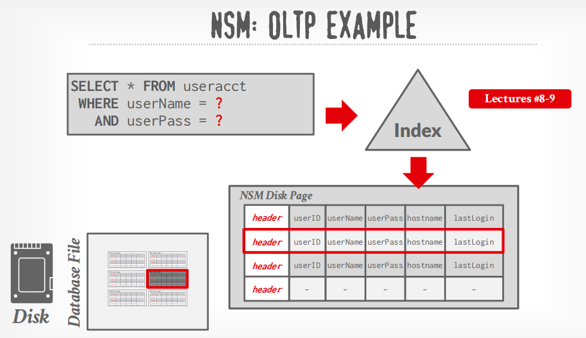
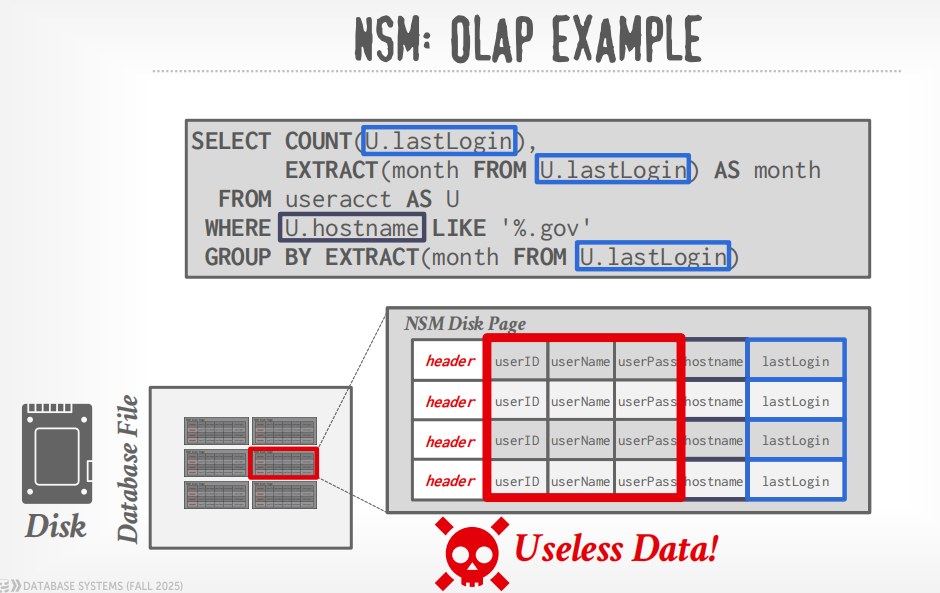
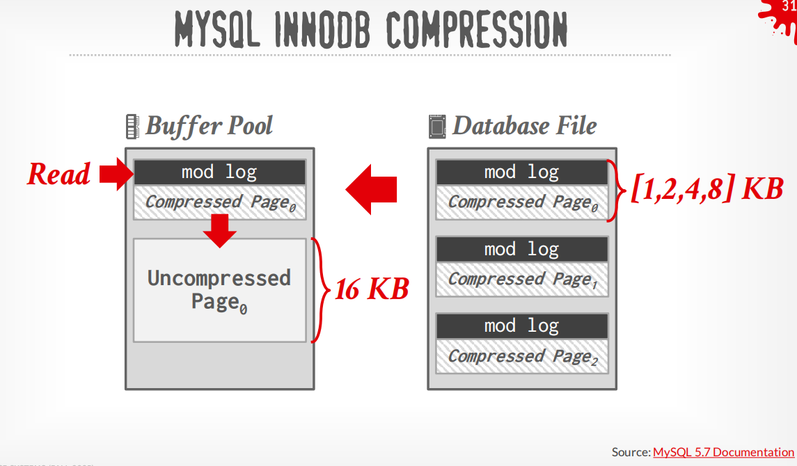
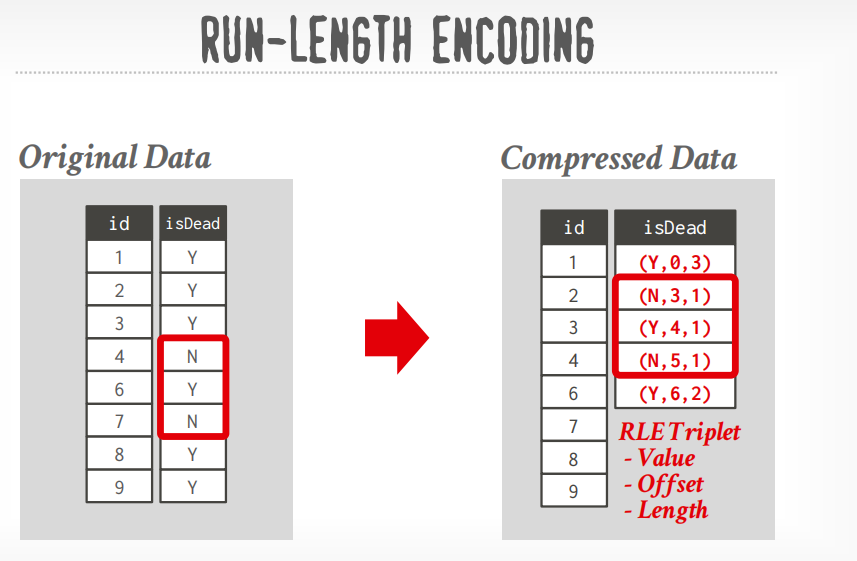
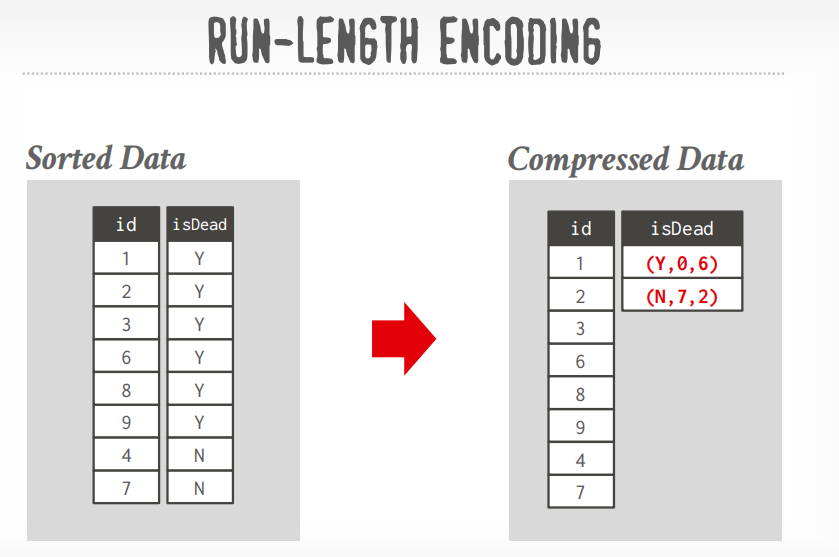
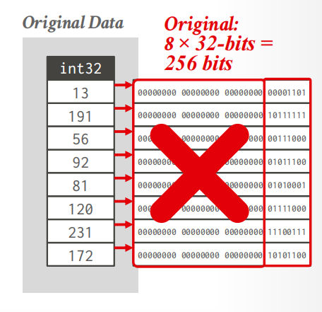
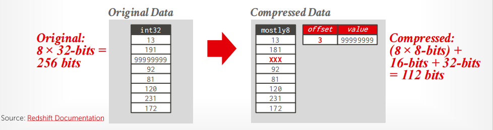
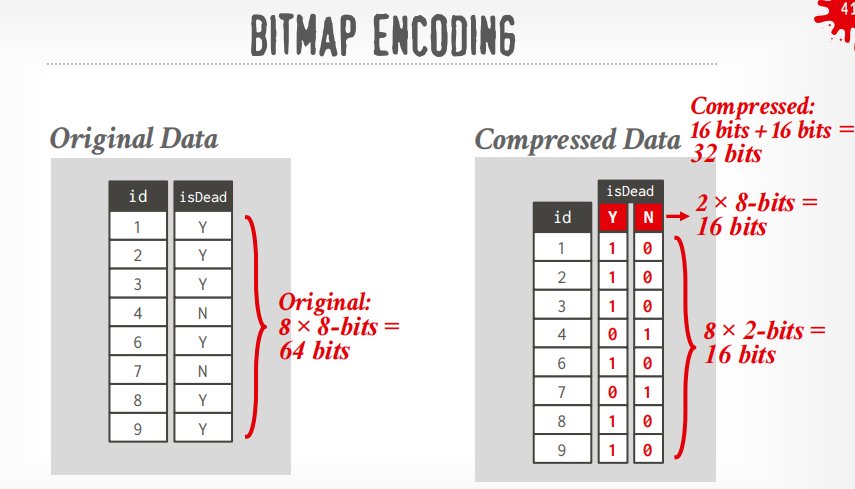
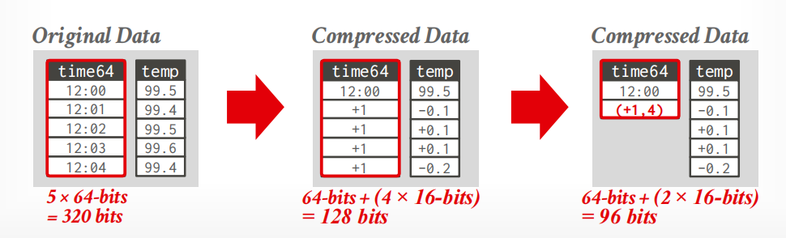

# **Lecture #06: Storage Models & Compression** 

**15-445/645 Database Systems (Fall 2025)** https://15445.courses.cs.cmu.edu/fall2025/ Carnegie Mellon University Andy Pavlo 

## **1 Database Workloads** 

### **OLTP: Online Transaction Processing** 

An OLTP workload is characterized by fast, short running operations, repetitive operations and simple queries that operate on single entity at a time. OLTP workloads typically handle more writes than reads, and only read/update a small amount of data each time. 

An example of an OLTP workload is the Amazon storefront. Users can add things to their cart and make purchases, but the actions only affect their account. 

This is usually the kind of application that people build first

### **OLAP: Online Analytical Processing** 

An OLAP workload is characterized by long running, complex queries (which often involves computing aggregates) and reads on large portions of the database. In OLAP workloads, the database system is often analyzing and deriving new data from existing data collected on the OLTP side. 

An example of an OLAP workload that analyzes data collected on the OLTP side is personalized Amazon shopping ads. The website analyzes all of data collected from users’ carts and purchases, and then selects different ads for different users. 

### **HTAP: Hybrid Transaction + Analytical Processing** 

A new type of workload (which has become popular recently) is HTAP, where OLTP and OLAP workloads are present together on the same database instance. 

#### **Workload Focus:** 

- OLTP - Simple Queries, Write Heavy 

- OLAP - Complex Queries, Read Heavy 

- HTAP - A mix of both the above 

## **2 Storage Models** 

A DBMS's storage model specifies how it physically organizes tuples on disk and in memory.

→ Can have different performance characteristics based on the target workload (OLTP vs. OLAP).
→ Influences the design choices of the rest of the DBMS.

There are different ways to store tuples in pages.
Choice #1: N-ary Storage Model (NSM)
Choice #2: Decomposition Storage Model (DSM)
Choice #3: Hybrid Storage Model (PAX)


 

### **N-Ary Storage Model (NSM)** 

In the n-ary storage model, the DBMS stores all of the attributes for a single tuple (row) contiguously in a single page. Thus, it is also known as a **row store** . This approach is ideal for OLTP workloads where requests are write-heavy and accesses are mostly individal entities. It is ideal because it takes only one fetch to be able to get all of the attributes for a single tuple. NSM pages are typically some constant multiple of **4KB** hardware pages. 







#### **Advantages:** 

- Fast inserts, updates, and deletes. 

- Good for queries that need the entire tuple (OLTP). 

- Can use index-oriented physical storage for clustering. 

#### **Disadvantages:** 

- Inefficient for scanning large portions of the table and/or a subset of the attributes. 

- Poor memory locality in access patterns. 

- Difficult to apply compression because of multiple value domains within a single page. 

### **Decomposition Storage Model (DSM)** 

In the decomposition storage model, the DBMS stores a single attribute (column) for all tuples contiguously in a block of data. Thus, it is also known as a **column store** . This model is ideal for OLAP workloads with many read-only queries that perform large scans over a subset of the table’s attributes. 

#### **Advantages:** 

- Reduces the amount of I/O wasted per query because the DBMS only reads the attributes that it needs for a given query. 

- Better (faster) query processing because of increased locality and cached data reuse. 

- Better data compression. 

#### **Disadvantages:** 

- Slow for point queries, inserts, updates, and deletes because of tuple splitting/stitching. 

To put the tuples back together when using a column store, there are two common approaches: 

- The most commonly used approach is **fixed-length offsets** . Here, the value in a given column will belong to the same tuple as the value in another column at the same offset. Therefore, every single value within the column will have to be the same length. 

- A less common approach is to use **embedded tuple ids** . Here, for every attribute in the columns, the DBMS stores a tuple id (ex: a primary key) with it. Then, the system would also store a mapping to tell it how to jump to every attribute that has that id. Note that this method has a large storage overhead because it needs to store a tuple id for every attribute entry. 

### **Partition Attributes Across (PAX)** 

In the hybrid Partition Attributes Across storage model, the DBMS vertically partitions attributes within a database page. The goal of doing so is to get the benefit of faster processing on columnar storage while retaining the spatial locality benefits of row storage. 

In PAX, the rows are horizontally partitioned into groups of rows. Within each row group, the attributes are vertically partitioned into columns. Each row group is similar to a column store for its subset of the rows. 

A PAX file has a global header containing a directory with offsets to the file’s row groups, and each row group maintains its own header with meta-data about its contents. 

## **3 Database Compression** 

Compression is widely used in disk-based DBMSs as disk I/O is (almost) always the main bottleneck. It is especially popular in systems that have read-only analytical workloads. The DBMS can fetch more useful tuples, if they have been compressed beforehand at the cost of greater computational overhead for 


#### compression and decompression. 

In-memory DBMSs are more complicated since they do not have to fetch data from disk to execute a query. Memory is much faster than disks, but compressing the database reduces DRAM requirements and processing. They have to strike a balance between **speed** vs. **compression ratio** . Compressing the database reduces DRAM requirements and may decrease CPU costs during query execution. 

Given this, we want a database compression scheme to have the following properties: 

- Goal #1: Must produce fixed-length values. 
  The only exception is variable length data stored in separate pools. This is because the DBMS should follow word-alignment and be able to access data using offsets. 

- Goal #2: Allow the DBMS to postpone decompression as long as possible during query execution ( **late materialization** ). 

- Goal #3: Must be a **lossless** scheme 
  because people do not like losing data. 
  Any kind of **lossy** compression has to be performed at the application level. 


### **Compression Granularity** 

The kind of data we want to compress greatly affects which compression schemes can be used. There are four levels of compression granularity: 

- **Block Level:** Compress a block of tuples for the same table. 

- **Tuple Level:** Compress the contents of the entire tuple (NSM only). 

- **Attribute Level:** Compress a single attribute value within one tuple. Can target multiple attributes for the same tuple. 

- **Columnar Level:** Compress multiple values for one or more attributes stored for multiple tuples (DSM only). This allows for more complicated compression schemes. 

## **4 Naive Compression** 

The DBMS compresses data using a general purpose algorithm (e.g., Deflate, LZO, LZ4, Snappy, Oracle OZIP, Zstd, Lizard). Although there are several compression algorithms that the DBMS could use, engineers often choose ones that often provides lower compression ratio in exchange for faster compression/decompression. 

The DBMS compresses disk pages, pads them to a power of 2KBs and stores them into the buffer pool. However, every time the DBMS tries to read/update data, the compressed data in the buffer pool must first be decompressed. For blind writes, no decompression required. 

Since accessing data requires decompression of compressed data, this limits the scope of the compression scheme. If the goal is to compress the entire table into one giant block, using naive compression schemes would be impossible since the whole table needs to be compressed/decompressed for every access. Therefore, MySQL breaks the table into smaller chunks since the compression scope is limited. 

Another problem is that these naive schemes also do not consider the high-level meaning or semantics of the data. The algorithm is oblivious to both the structure of the data, and how the query is planning to access the data. Thus, this eliminates the opportunity to utilize late materialization, since the DBMS cannot tell when it can delay the decompression of data. 




https://dev.mysql.com/doc/refman/9.7/en/innodb-compression-internals.html


## **5 Columnar Compression** 

Built-in compression schemes that allow DBMSs to read tuples without having to decompress them to their original form. 


### **Run-Length Encoding (RLE)** 

RLE compresses runs (consecutive instances) of the same value in a single column into triplets: 

- The value of the attribute 

- The start position in the column segment (offset) 

- The number of elements in the run (length) 




The DBMS should `sort` the columns intelligently beforehand to maximize compression opportunities. This clusters duplicate attributes, thereby increasing the compression ratio. Note that the effectiveness of RLE greatly depends on the underlying data characteristics (e.g. number and frequency of attributes in each data). 

### **Bit-Packing Encoding** 


When all values for an attribute are less than the value’s declared largest size, store them with fewer bits. 

Use bit-shifting tricks to operate on multiple values in a single word.

### **Patching / Mostly Encoding** 


Bit-packing variant that uses a special marker to indicate when a value exceeds the largest size and then maintains a look-up table to store them. Use when values are ”mostly” less than the largest size. 

The remaining values that cannot be compressed are stored in their raw form.

### **Bitmap Encoding** 

The DBMS stores a separate bitmap for each unique value of a particular attribute where an offset in the vector corresponds to a tuple. 

- The _i_<sup>_th_</sup> position in the bitmap corresponds to the _i_<sup>_th_</sup> tuple in the table and indicates whether that value is present in the attribute of that tuple. 
- The bitmap is typically segmented into chunks to avoid allocating large blocks of contiguous memory. 



This approach is only practical **if the value cardinality is low**, since the size of the bitmap is linearly proportional to the cardinality of the attribute value. If the cardinality of the value is high, then the bitmap can become larger than the original data set. 


Assume we have 10 million tuples.
43,000 zip codes in the US.

```SQL
→ 10000000 × 32-bits = 40 MB
→ 10000000 × 43000 = 53.75 GB

CREATE TABLE customer (
 id INT PRIMARY KEY,
 name VARCHAR(32),
 email VARCHAR(64),
 address VARCHAR(64),
 zip_code INT
);

```

Every time the application inserts a new tuple, the DBMS must extend 43,000 different bitmaps.

There are compressed data structures to for sparse data sets (for example: Roaring Bitmaps) 


### **Delta Encoding** 

Instead of storing exact values, record the difference between values that follow each other in the same column. The base value can be stored in-line or in a separate look-up table. We can also use RLE on the stored deltas to get even better compression ratios. 
→ Store base value in-line or in a separate look-up table. 
→ Combine with RLE to get even better compression ratios.
Frame-of-Reference Variant: Use global min value.




### **Dictionary Compression** 

The most common database compression scheme is dictionary encoding. The DBMS replaces frequent patterns in values with smaller codes. It then stores only these codes and a data structure (i.e. the dictionary) that maps these codes to their original value. A dictionary compression scheme needs to support fast encoding/decoding, and needs to be order-preserving if it needs to work with range queries. 

#### Encoding and Decoding

The dictionary needs to decide how to **encode** (convert uncompressed value into its compressed form) and **decode** (convert compressed value back into its original form) data. As such, it is not possible to use hash functions. 


#### Order-preserving encoding

The encoded values also need to support sorting in the same order as original values (i.e. **order-preserving encodings** ). This ensures that the compressed queries run on compressed data return results that are consistent with uncompressed queries run on the original data. This order-preserving property allows operations to be performed directly on the codes. 

On certain queries (such as string match), queries can be executed faster. 


##### Collation
The encoded values need to support the same collation  as the original values

Collation is the rule used to determine the ordering of strings.
For a simple case, suppose the database uses ordinary lexicographic/ASCII-like ordering:
```
Andrea
Andy
Jignesh
Mr.Pickles
```
Then: Andrea < Andy < Jignesh < Mr.Pickles

An order-preserving dictionary assigns codes according to this order:

```
Original value       Code

Andrea                10
Andy                  20
Jignesh               30
Mr.Pickles            40
```
Therefore: 
- Andrea < Andy corresponds to 10 < 20
- Andy < Jignesh corresponds to 20 < 30
So the DBMS can compare codes instead of strings.

More precisely:
If A < B according to the database's string collation, then code(A) < code(B) must also hold.

And similarly for equality:
A = B  →  code(A) = code(B)


##### Why does this matter?
Suppose the original query is:
```SQL
WHERE name >= 'Andy'
  AND name < 'Mr.Pickles'
```
With the dictionary:
Andrea     → 10
Andy       → 20
Jignesh    → 30
Mr.Pickles → 40
we can transform the predicate into something conceptually like:

```SQL
WHERE name_code >= 20
  AND name_code < 40
```

The DBMS doesn't have to repeatedly compare strings such as:  "Jignesh" < "Mr.Pickles"
It can compare: 30 < 40
That's a major benefit in a column store.


#### LIKE 'And%' → BETWEEN 10 AND 20? 

```SQL
SELECT * FROM users  WHERE name LIKE 'And%'
---in original data  transformed to 

SELECT * FROM users WHERE name BETWEEN 10 AND 20
----in Compressed Data?
```

Your dictionary is:
```
code   value
10     Andrea
20     Andy
30     Jignesh
40     Mr.Pickles
```

The predicate is: `name LIKE 'And%'`
Let's ask: Which dictionary values start with "And"?

```
Andrea     ← starts with "And"
Andy       ← starts with "And"
Jignesh    ← no
Mr.Pickles ← no
```

So the matching dictionary entries are:
Andrea → 10
Andy   → 20
Therefore, for this particular dictionary, the matching codes happen to be: 10 through 20

So the DBMS can identify the matching code range: 10 <= code <= 20
or conceptually:  `WHERE name_code BETWEEN 10 AND 20`
But don't think that LIKE is generally equivalent to BETWEEN. That's not true.

The DBMS first uses the dictionary to determine: 
Which dictionary values satisfy LIKE 'And%'?

Then it obtains the corresponding code range.
For example, suppose the dictionary were:
```
10  Andrea
20  Andy
30  Andrew
40  Bob
50  Candy
```
Then: `LIKE 'And%'` would correspond to: 10, 20, 30
and potentially a code range: 10–30
The key is that all strings beginning with And are contiguous under lexicographic ordering.


Why does LIKE 'And%' correspond to a range?
Think about the sorted dictionary:
```
Andrea
Andy
Andrew
Bob
Candy
David
...
```

All strings beginning with:"And" 
form a contiguous region:

```
                 matching region
                      ↓↓↓↓↓
Andrea
Andy
Andrew
───────────────
Bob
Candy
David
```

Therefore, if the dictionary is sorted, the DBMS can find the first and last dictionary entries satisfying the prefix.
Conceptually:

```
"And..." prefix
      ↓
find lower boundary
      ↓
Andrea
      ...
find upper boundary
      ↓
Andrew
```

Then:
Andrea → 10
Andrew → 30
So the column predicate can become approximately: code BETWEEN 10 AND 30
This is the connection between:
order-preserving dictionary encoding and prefix/string matching.


#### Why Perform scan on column VS Only need to access dictionary
```SQL
SELECT name FROM users WHERE name LIKE 'And%'
---Still must perform scan on column?

SELECT DISTINCT name FROM users WHERE name LIKE 'And%'
--- just Only need to access dictionary?

```


Because the dictionary tells us which codes match, but it doesn't tell us which rows contain those codes.
Suppose:

```
Dictionary:

10 → Andrea
20 → Andy
30 → Jignesh
40 → Mr.Pickles
```

and the compressed column is:

```
Row       name_code

1            30
2            20
3            40
4            10
5            30
6            20
7            40
8            20
```

The dictionary tells us:
10 → Andrea  ✓
20 → Andy    ✓
Therefore:
matching codes = {10, 20}
But now we need to answer:
Which rows contain code 10 or 20?

We must inspect the encoded column:

```
30 → no
20 → YES
40 → no
10 → YES
30 → no
20 → YES
40 → no
20 → YES
```

Therefore we need to scan the encoded column.
The important distinction is:

```
Dictionary
    │
    │ tells us WHAT values match
    ↓
{10, 20}
    │
    │ but where are these codes?
    ↓
Encoded column
    │
    │ tells us WHICH ROWS match
    ↓
rows 2, 4, 6, 8
```


So:
Dictionary lookup solves the value-domain problem, not the row-location problem.


why can SELECT DISTINCT name ... only need the dictionary?

This is the beautiful part of dictionary encoding.
Your query:

```SQL
SELECT DISTINCT name
FROM users
WHERE name LIKE 'And%';
```

is asking: "What are the distinct names satisfying this condition?"

It is not asking: "Which rows contain these names?"

The dictionary already contains one entry per distinct value.
So: 

```
Dictionary:

10 → Andrea
20 → Andy
30 → Jignesh
40 → Mr.Pickles
```

We can inspect the dictionary:

```
Andrea     → matches
Andy       → matches
Jignesh    → doesn't match
Mr.Pickles → doesn't match
```

and immediately produce:
```
Andrea
Andy
```
We don't care whether Andrea occurs in:
```
1 row
100 rows
1 million rows
```

because DISTINCT removes duplicates anyway.


Compare the two queries
This is probably the most important thing to remember.
```SQL
Query A
SELECT name
FROM users
WHERE name LIKE 'And%';
```

Need:

```
Dictionary
    ↓
find matching codes
    ↓
10, 20
    ↓
scan encoded column
    ↓
find rows containing 10 or 20
    ↓
return names
```
So the column still matters.

Query B
```SQL
SELECT DISTINCT name
FROM users
WHERE name LIKE 'And%';
```
Need:
```
Dictionary
    ↓
find values satisfying LIKE
    ↓
Andrea
Andy
    ↓
done
```

No need to inspect the encoded column for the logical result.


An even more interesting example
Suppose the table contains 1 billion rows:

```
users
────────────────────────
1,000,000,000 rows
```

but only 100 distinct names:
```
Dictionary
────────────────────────
100 entries
```

And:
```SQL
SELECT DISTINCT name
FROM users
WHERE name LIKE 'And%';
```
The answer might be determined by inspecting only those 100 dictionary entries.
The 1-billion-row encoded column isn't necessary to determine the set of distinct matching values.
That's one of the reasons dictionary encoding is particularly powerful for low-cardinality columns in OLAP systems.


One subtle correction: DISTINCT is not magic
There's an important qualification.
This:
```SQL
SELECT DISTINCT name
FROM users
WHERE name LIKE 'And%';
```

can potentially be answered from the dictionary **only if the query semantics allow that.**

For a simple dictionary-encoded column, the dictionary represents the set of distinct values that occur in that column.

So for: `DISTINCT(name)`
the dictionary already has exactly the information we need.
But if you ask something involving row-level relationships, you need the encoded column.
For example:

```SQL
SELECT name, age
FROM users
WHERE name LIKE 'And%';
```

Now the dictionary can't tell us which age belongs to which name.
We need row-level information.


The key sentence to remember
**The dictionary tells you which values/codes satisfy the predicate; the encoded column tells you which tuples contain those codes.**

And `DISTINCT` is special because it asks only for the set of values, which the dictionary already represents.
One final subtlety: this all assumes the dictionary is **order-preserving under the DBMS's actual collation**. If the collation is case-insensitive, accent-sensitive, locale-specific, etc., the ordering/range reasoning has to follow that collation—not simple ASCII orderin
